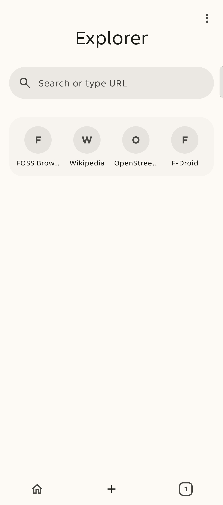
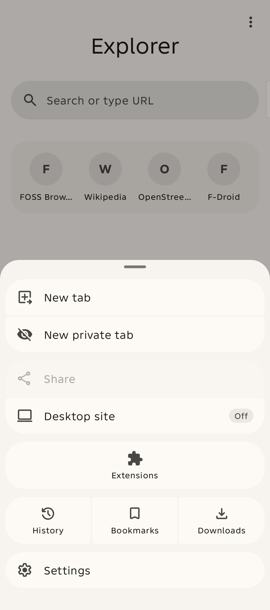
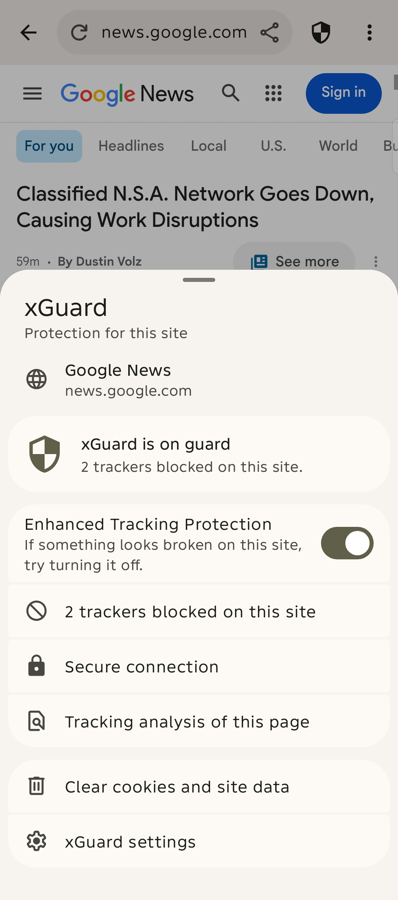
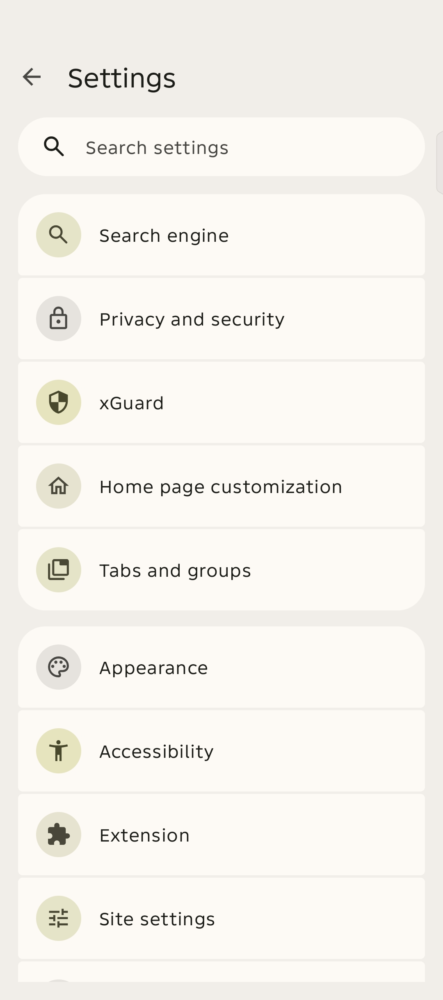
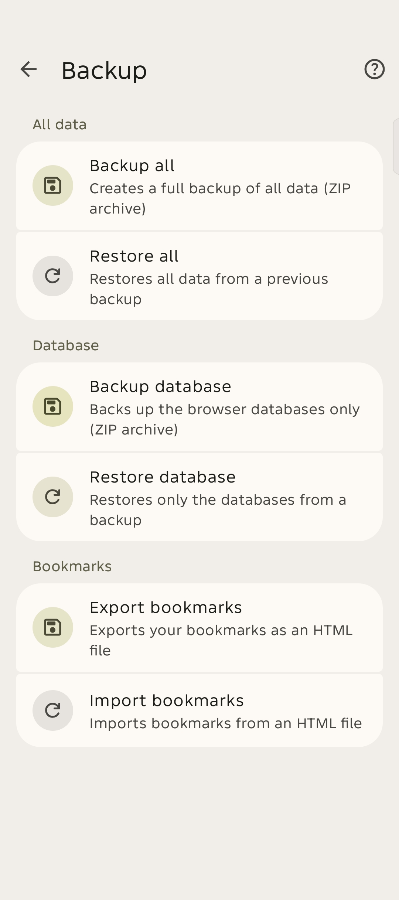

# Explorer

**Explorer is an open-source Android web browser built with Kotlin and Android System WebView.** I focus on keeping it practical, customizable, privacy-friendly, and lightweight while adding features that aren't normally available in Android browsers.

---

<div align="center">

<h1><a id="screenshots"></a>Screenshots</h1>








</div>

---

One of its main features is **Chrome Web Store extension support**. Android System WebView does not natively provide Chrome's extension system or `chrome.*` APIs, so I built a custom compatibility layer around WebView. Explorer handles extension downloads and installation, reads manifests, injects supported scripts, provides compatible extension APIs through a JavaScript-to-Kotlin bridge, and hosts extension interfaces such as popups.

This is a custom implementation, not native Chrome extension support built into Android System WebView. Compatibility depends on the APIs an extension uses; not every Chrome extension is guaranteed to work.

## Chrome Web Store extensions

### How extensions work

1. **Download:** Explorer retrieves an extension package from the Chrome Web Store.
2. **Extract and inspect:** The CRX package is unpacked and its manifest is parsed to identify scripts, permissions, popup pages, and other metadata.
3. **Install:** Explorer prepares the extension and presents its requested permissions.
4. **Run scripts:** Supported content scripts and styles are injected into matching pages.
5. **Provide APIs:** A JavaScript compatibility layer exposes supported `chrome.*` APIs and communicates with native Kotlin code through a bridge.
6. **Run background code:** Explorer hosts background code in separate, hidden WebViews. Manifest V3 service-worker files are handled by this custom runtime; they are not running as native WebView service workers.
7. **Show extension pages:** Popup and other extension pages are displayed through Explorer's extension interface.

### Extension architecture

| Component | Responsibility |
|---|---|
| `CrxDownloader` | Downloads extension packages |
| `CrxExtractor` | Extracts CRX packages |
| `ManifestParser` | Reads extension manifests |
| `ExtensionStore` | Installs and manages extensions |
| `ExtensionRuntime` | Coordinates extension execution and script injection |
| `ExtensionScripts` | Provides the JavaScript compatibility layer |
| `ChromeApiBridge` | Connects extension JavaScript with native Kotlin functionality |
| `ExtensionBus` | Handles background execution and messaging |
| `ExtensionPopup` | Displays extension popup interfaces |
| `ExtensionFiles` | Serves extension resources |

**Compatibility and security:** Explorer implements a subset of Chrome's extension APIs, so some extensions and API methods may not work as they do in desktop Chrome. Background execution is a WebView-based approximation rather than the native Chrome service-worker lifecycle. Extension package signature verification is not currently implemented, so only install extensions you trust.

## Features

- Chrome Web Store extension installation and management
- Material 3 interface with dynamic colours
- Light and dark themes
- Customizable home page
- Multiple tabs and tab management
- Private browsing
- Bookmarks and browsing history
- Download manager
- Custom search engines
- Per-site privacy profiles and settings
- Ad and tracker blocking
- Cookie-banner blocking
- Reader mode
- Page zoom
- Desktop site mode
- Browsing data management
- Backup and restore
- xGuard

## Technology

| Property | Details |
|---|---|
| Platform | Android |
| Languages | Kotlin and Java |
| Browser engine | Android System WebView |
| UI | Android Views and Material Components |
| Minimum Android version | Android 8.0 (API 26) |
| Target SDK | API 37 |
| Package name | `com.rpooi3.explorer` |
| Current version | 17.4.2 |

### Ad and tracker blocking

Explorer's ad-blocking engine is my own implementation. It uses filter-list rules and matching methods inspired by the Adblock Plus rule format, including URL, path, and request-type matching. It also supports cosmetic filtering by applying CSS to hide selected page elements.

Explorer uses filter lists such as EasyList and EasyPrivacy, as well as StevenBlack's unified hosts file. These lists are downloaded, parsed, and matched without modifying their contents. Their respective licensing terms are described below.

## Building

### Requirements

- JDK 17 or newer
- Android SDK Platform 37
- Android Build-Tools 37
- Android Studio (recommended)

### Build commands

```bash
# Build debug APK
./gradlew assembleDebug

# Run unit tests
./gradlew testDebugUnitTest

# Run lint checks
./gradlew lintDebug

# Build release APK
./gradlew assembleRelease
```

For signed release builds, configure your signing credentials in `keystore.properties` in the project root. Do not commit signing keys or private signing credentials.

## Code ownership and third-party notices

Explorer is an independent project. The project contains my original Explorer codes as well as specifically identified code, designs, schemas, texts, and other material from upstream projects. The following notes describe those origins and their applicable licenses.

### 1. Explorer — GNU General Public License v3.0

The following parts are Explorer's own code and are licensed under **GPL-3.0**:

- Browser bars, menus, tab switcher, and home page
- History and bookmarks screens
- Settings screens and xGuard
- Extension host and extension compatibility runtime
- Ad-blocking engine
- Extension installation prompt implementation
- Layouts, interface text, tests, and development tools
- App icon and logo

### 2. FOSS Browser

Project: [codeberg.org/Gaukler_Faun/FOSS_Browser](https://codeberg.org/Gaukler_Faun/FOSS_Browser)

A little under half of the code is actually derived from FOSS Browser. This includes:

- Tab and WebView implementation, including `NinjaWebView` and its WebView clients
- A large part of the browser screen that drives the tab and WebView
- Per-site privacy profiles and their storage
- Cookie-banner blocker
- Custom redirects
- Site-icon cache
- Download saving
- Browsing-data deletion
- Backup functionality

See the FOSS Browser project for its original licensing and copyright notices. These portions retain their applicable upstream terms.

### 3. Cromite — GNU General Public License v3.0

Project: [github.com/uazo/cromite](https://github.com/uazo/cromite)

Explorer uses the following Cromite-derived material:

- The extension installation prompt's wording and permission-warning lines, including the “Add [name]?”, “It can:”, permission list, “Cancel”, and “Add extension” wording.
- The ad-blocking method: Adblock Plus rules matched by URL, path, and request type, plus cosmetic rules applied through a stylesheet injected into the page before it is painted.

The ad-filter matching engine itself (`AdFilter` / `AdBlocker`) is Explorer's own code. The Cromite upstream link is also included in Explorer's Legal information, directly below Chromium's.

### 4. Chromium project — BSD 3-Clause License

Project: [github.com/chromium/chromium](https://github.com/chromium/chromium)

Copyright The Chromium Authors.

Explorer uses two groups of Chromium-derived material:

**Offline page and game**
- The offline page and its dinosaur game, from Chromium 86.0.4240.198.

**Interface text, layouts, icons, and tab bookkeeping**
- Settings-screen text
- Long-press link and picture menu text
- Tab-switcher text and arrangement
- Private-tab new-tab page text and arrangement
- Site-setting icons
- Tab bookkeeping (`TabList` / `TabModel`), ported to Kotlin from Chromium 160.0.8161.0

### 5. Firefox for Android — Mozilla Public License 2.0

Project: [github.com/mozilla-firefox/firefox](https://github.com/mozilla-firefox/firefox)

Copyright Mozilla and contributors.

Explorer uses the following Firefox for Android interface arrangements and text:

- Three-dot menu arrangement
- Download confirmation question and its wording
- Panel displayed behind the shield, including its arrangement and text

### 6. Mozilla application-services — Mozilla Public License 2.0

Project: [github.com/mozilla/mozilla/application-services/blob/main/components/places/src/db/schema.rs](https://github.com/mozilla/application-services/blob/main/components/places/src/db/schema.rs)

Copyright Mozilla.

Explorer uses:
- The history and bookmarks database schema from Mozilla's Places schema file, unchanged.
- The address hash implementation, ported to Kotlin.

### 7. Readability 0.6.0 — Apache License 2.0

Project: [github.com/mozilla/readability](https://github.com/mozilla/readability)

Copyright Arc90 Inc.; distributed via Mozilla.

Readability identifies and extracts the main article content of a page for Explorer's simplified reader view.

### 8. AndroidX, Material Components, Kotlin standard library, and Material Design Icons — Apache License 2.0

These dependencies are included through the build and include:

- AndroidX Core
- AppCompat
- Preference
- WebKit
- RecyclerView
- DocumentFile
- Material Components for Android (1.14.0)
- Kotlin standard library
- Material Design Icons

Their respective authors and projects retain their copyrights and license terms.

### 9. Ad-blocking filter lists

Explorer downloads, parses, and matches the following filter-list sources without modifying their contents:

- **EasyList and EasyPrivacy:** The lists are published by the EasyList authors under **GNU GPL v3.0 or later, or CC BY-SA 3.0 or later.**. The code used to build the lists is licensed under **GPL-3.0**.
- **StevenBlack's unified hosts file:** MIT License.

Please consult each upstream project's own license and attribution files for the complete terms.

## License

Explorer's original code is licensed under the **GNU General Public License v3.0**. This repository also contains or uses third-party components and materials under their own licenses, as listed above.

A license applying to Explorer's original code does not replace or override the licenses of third-party components. Please retain applicable copyright notices, license texts, and attribution when redistributing the project.

## Contribution 

Please read the [Contribution guideline](https://github.com/Nadib330/Foss-Explorer/blob/main/CONTRIBUTING.md).


---

**Developed by rpooi3 (also known as rpooi3 studio and Nadib330.)**
